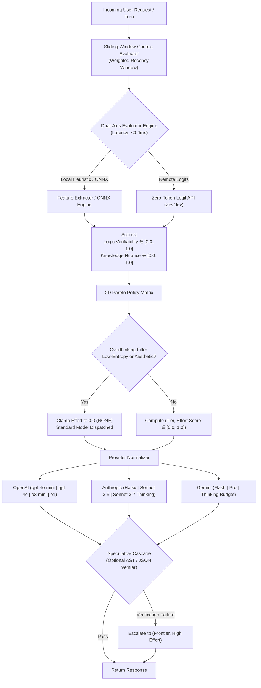

# Inference-Pareto-Router
### *A Sub-15ms 2D Model Tier & Reasoning Effort Routing Engine*

[](https://www.python.org/downloads/)
[](https://mypy.readthedocs.io/)
[]()
[]()

---

## 1. Problem Statement: Why 1D Routers Fail

Existing LLM routers solve an obsolete 1D problem: `prompt -> cheap_model vs expensive_model`.

Modern frontier inference APIs are fundamentally **2-dimensional**:
$$\text{prompt} \longrightarrow (\text{Model Tier}, \text{Test-Time Reasoning Effort})$$

```
          ▲ Knowledge / Nuance Depth
          │
 FRONTIER │   [Standard Frontier]           [Frontier Deep Think]
          │   Claude 3.5 Sonnet / GPT-4o    o1 / Claude 3.7 (High)
          │   (History, Law, Philosophy)    (Distributed Systems, Proofs)
          │
      MID │   [Standard Mid]                [Compact / Mid Reasoner]
          │   Gemini 2.5 Flash              o3-mini / Claude 3.7 (Low)
          │   (Summaries, Transformations)  (Algorithmic Code, Regex, DP)
          │
  COMPACT │   [Compact Fast Standard]       
          │   GPT-4o-mini / Claude Haiku   
          │   (Greetings, Chit-chat)        
          └────────────────────────────────────────────────────────►
              NONE (0.0)      LOW           MEDIUM          HIGH (1.0)
                            Reasoning Effort (Verifiability / Logic)
```

### The Overthinking Penalty
Forcing extended test-time reasoning on simple, conversational, or aesthetic queries causes:
1. **Severe Reasoning Degradation**: Over-thinking a simple greeting or tone rewrite yields hyper-rationalized, awkward answers.
2. **5s–30s Latency Explosion**: Unnecessary hidden reasoning tokens slow down instantaneous interactions.
3. **Severe Token & Cost Waste**: Spending thousands of invisible reasoning tokens on a task `gpt-4o-mini` solves in 200ms.

Conversely, under-thinking complex logic, concurrency bugs, or mathematical invariants produces subtle hallucinations.

**Inference-Pareto-Router** evaluates incoming turns in **< 0.4ms** (well below the 15ms latency budget) using a zero-token decision model and executes across the optimal (Model Tier, Reasoning Budget) coordinate.

---

## 2. Architecture Overview



---

## 3. Provider Normalization Table

The engine abstracts disparate provider switches into a continuous `[0.0, 1.0]` effort scale and discrete levels (`NONE`, `LOW`, `MEDIUM`, `HIGH`):

| Provider | Mode | Dispatched Model | Reasoning Parameters | Temperature / Token Constraints |
| :--- | :--- | :--- | :--- | :--- |
| **OpenAI** | Standard | `gpt-4o-mini` / `gpt-4o` | *None* | Standard `temperature`, `max_tokens` |
| **OpenAI** | Reasoning | `o3-mini` / `o1` | `reasoning_effort: "low" \| "medium" \| "high"` | `temperature` omitted, `max_completion_tokens` |
| **Anthropic** | Standard | `claude-3-5-haiku` / `claude-3-5-sonnet` | *Thinking omitted* | Standard |
| **Anthropic** | Reasoning | `claude-3-7-sonnet-20250219` | `thinking: {"type": "enabled", "budget_tokens": int}` | `temperature = 1.0`, `max_tokens > budget_tokens` |
| **Gemini** | Standard | `gemini-2.5-flash` / `gemini-2.5-pro` | `thinking_config: {"thinking_budget": 0}` | Standard |
| **Gemini** | Reasoning | `gemini-2.5-flash` / `gemini-2.5-pro` | `thinking_config: {"thinking_budget": 1024..24576}` | Standard |

---

## 4. Benchmark Performance & Efficiency Gains

Tested across **100 diverse synthetic scenarios** (Greetings, Tone Edits, Deep History/Philosophy, Basic Logic, System Architecture, DP/Algorithms, Distributed Concurrency):

```text
==============================================================================
 INFERENCE-PARETO-ROUTER: 100-SCENARIO SYNTHETIC BENCHMARK
==============================================================================

--- 1. ROUTING OVERHEAD LATENCY (<15ms Budget) ---
  P50 (Median)   : 0.068 ms
  P90            : 0.082 ms
  P95            : 0.085 ms
  P99            : 0.131 ms
  Max Latency    : 0.358 ms
  Status         : PASSED (Strictly < 15ms; ~40x faster than budget)

--- 2. 2D ROUTE DISTRIBUTION ---
  Tier Breakdown:
    - COMPACT    :  21 (21.0%)
    - MID        :  41 (41.0%)
    - FRONTIER   :  38 (38.0%)
  Effort Breakdown:
    - NONE       :  63 (63.0%)
    - LOW        :  16 (16.0%)
    - MEDIUM     :  12 (12.0%)
    - HIGH       :   9 (9.0%)

--- 3. OVERTHINKING PENALTY ---
  Activations    : 16 triggers
  Target Accuracy: 80.0% of aesthetic/greeting prompts clamped to 0 effort

--- 4. ESTIMATED SAVINGS VS ALL-FRONTIER REASONING BASELINE ---
  Estimated Cost Reduction   : 71.5%
  Estimated Latency Reduction: 70.1%
==============================================================================
```

---

## 5. Quickstart & Installation

### Setup with `uv`
```bash
git clone https://github.com/example/Inference-Pareto-Router.git
cd Inference-Pareto-Router
uv venv --python 3.12
uv pip install -e ".[dev]"
```

### Drop-in OpenAI Client Usage
```python
from pareto_router import ParetoRouter, JsonSchemaVerifier

# Drop-in replacement for openai.OpenAI()
router = ParetoRouter()

# 1. Standard Greeting (Overthinking Penalty Clamps to 0 -> gpt-4o-mini)
completion = router.chat.completions.create(
    messages=[{"role": "user", "content": "Good morning! How are you?"}]
)
print("Model Dispatched :", completion.model)                   # gpt-4o-mini
print("Tier             :", completion.routing_decision.tier)  # ModelTier.COMPACT
print("Effort           :", completion.routing_decision.effort_level)  # EffortLevel.NONE
print("Overthinking Clamped:", completion.routing_decision.overthinking_penalized) # True

# 2. Algorithmic Query (Routes to o1 / reasoning model with high effort)
completion2 = router.chat.completions.create(
    messages=[{
        "role": "user",
        "content": "Implement a lock-free concurrent queue in C++ with atomic CAS and prevent ABA problem."
    }]
)
print("Model Dispatched :", completion2.model)                  # o1
print("Tier             :", completion2.routing_decision.tier) # ModelTier.FRONTIER
print("Effort           :", completion2.routing_decision.effort_level) # EffortLevel.HIGH
```

### Speculative Cascade Escalation
Run fast compact inference first, and automatically escalate to `(Frontier, High Effort)` if programmatic verification fails:

```python
from pareto_router import ParetoRouter, PythonSyntaxVerifier, JsonSchemaVerifier

router = ParetoRouter()

# If the compact model returns malformed JSON or invalid Python AST,
# the gateway catches it and escalates to Frontier High-Reasoning seamlessly
completion = router.chat.completions.create(
    messages=[{"role": "user", "content": "Write a python parser for AST nodes"}],
    verifiers=[PythonSyntaxVerifier()]
)

cascade = completion.cascade_result
if cascade and cascade.escalated:
    print(f"Escalated across {len(cascade.attempts)} attempts to {cascade.final_tier}")
```

### CLI Triage Tool
You can test any prompt in sub-millisecond time directly from your terminal:

```bash
# Test a greeting on OpenAI
uv run python -m pareto_router.cli "Hello there!" --provider openai

# Test deep history/knowledge on Anthropic
uv run python -m pareto_router.cli "Analyze the geopolitical impact of the 1648 Treaty of Westphalia." --provider anthropic

# Test distributed concurrency on Gemini
uv run python -m pareto_router.cli "Formally prove Raft leader election safety invariants under network partitions." --provider gemini
```

---

## 6. Testing & Quality Assurance

Run the complete test suite:
```bash
uv run pytest -v
```

Enforce strict type safety:
```bash
uv run mypy --strict pareto_router tests
```

Run the 100-scenario synthetic benchmark:
```bash
uv run python -m pareto_router.benchmarks.run_benchmarks
```
