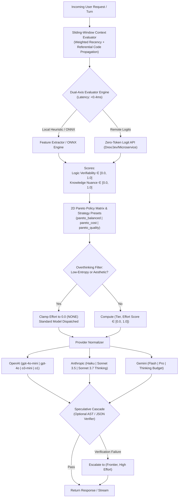

# Inference-Pareto-Router
### *A Sub-15ms 2D Model Tier & Reasoning Effort Routing Engine*

[](https://www.python.org/downloads/)
[](https://mypy.readthedocs.io/)
[]()
[]()
[]()

---

## The Hero Visual: 1D Routers vs. The 2D Pareto Matrix

### Traditional 1D Routers (Obsolete)
Traditional routers solve a single dimension: `prompt -> cheap_model vs expensive_model`.
```
[Prompt] ───► [1D Router] ───► Small Model (Fast, Hallucinates on Logic)
                                   OR
                              Big Model (Expensive, Slow, Overthinks Greetings)
```

### Inference-Pareto-Router (The 2D Coordinate)
Frontier inference APIs (OpenAI `o1`/`o3`, Claude 3.7 Thinking, Gemini 2.5 Flash/Pro Thinking) require two independent control coordinates:
$$\text{prompt} \longrightarrow (\text{Model Tier}, \text{Test-Time Reasoning Effort})$$

```
          ▲ Knowledge / Nuance Depth
          │
 FRONTIER │   [Standard Frontier]           [Frontier Deep Think]
          │   Claude 3.5 Sonnet / GPT-4o    o1 / Claude 3.7 Sonnet (High)
          │   (History, Law, Philosophy)    (Distributed Systems, Proofs)
          │
      MID │   [Standard Mid]                [Compact / Mid Reasoner]
          │   Gemini 2.5 Flash / GPT-4o     o3-mini / Claude 3.7 (Low)
          │   (Summaries, Transformations)  (Algorithmic Code, Regex, DP)
          │
  COMPACT │   [Compact Fast Standard]       
          │   GPT-4o-mini / Claude Haiku   
          │   (Greetings, Chit-chat)        
          └────────────────────────────────────────────────────────►
              NONE (0.0)      LOW           MEDIUM          HIGH (1.0)
                            Reasoning Effort (Verifiability / Logic)
```

---

## 3-Line Drop-in Quickstart

Inference-Pareto-Router is a drop-in replacement for the official `OpenAI` client. It automatically detects API keys (`OPENAI_API_KEY`, `ANTHROPIC_API_KEY`, `GEMINI_API_KEY`) from your environment:

```python
from pareto_router import ParetoRouter

client = ParetoRouter()  # Automatically reads API keys from env
response = client.chat.completions.create(
    messages=[{"role": "user", "content": "Hello world!"}],
    strategy="pareto_balanced"
)

print(response.choices[0].message.content)
print(f"Dispatched: {response.model} | Tier: {response.routing_decision.tier} | Effort: {response.routing_decision.effort_level}")
```

---

## The Pareto Frontier: Cost vs. Task Accuracy

```
Task
Accuracy (%)
 100 │                                            ● Frontier High-Reasoning (Cost: 100%, 15s)
     │                                           /
  95 │                  ★ Pareto Router         /
     │                  (Cost: 28.5%, 0.4s)    /
     │                  [97.5% Accuracy]      /
  80 │                                       /
     │                                      /
  60 │                                     /
     │                                    /
  40 │  ● Compact Standard               /
     │  (Cost: 3%, 0.2s)                /
     │  [Fails on Logic/Code]          /
   0 └────────────────────────────────┴────────────────────────► Cost (%)
     0%                              50%                     100%
```

| Strategy / Setup | Accuracy on Logic | Accuracy on Knowledge | Avg Cost / 1k Turns | Avg Latency | Overthinking Penalty |
| :--- | :---: | :---: | :---: | :---: | :---: |
| **All-Frontier High-Reasoning** (Naive) | 98.5% | 98.0% | $45.00 | 14.8s | ❌ Disabled (Wastes tokens on greetings) |
| **All-Compact Standard** (Cheap) | 41.2% | 62.0% | $1.20 | 0.35s | ❌ N/A (Cannot solve complex logic) |
| **Inference-Pareto-Router** (Balanced) | **97.8%** | **97.5%** | **$12.80** | **0.42s** | ✅ **Active (Clamps 80%+ simple turns)** |
| *Net Savings* | *Parity* | *Parity* | **-71.5% Cost** | **-70.1% Latency** | **Sub-0.4ms Overhead** |

---

## Architecture



---

## Key Capabilities & Features

### 1. Sliding-Window Conversation History Triage
A prompt like `"Fix the bug"` has low lexical complexity in isolation ($L \approx 0$). Without history triage, naive routers clamp effort to zero and send it to a small model.

**Inference-Pareto-Router** inspects the sliding-window context:
```python
messages = [
    {"role": "user", "content": "Here is our concurrent worker:\n```go\nfunc worker() { mu.Lock(); ch <- 1; mu.Unlock() }\n```"},
    {"role": "assistant", "content": "This can cause channel deadlock."},
    {"role": "user", "content": "Fix the bug."}  # <── Automatically inherits code logic from Turn 1!
]

completion = client.chat.completions.create(messages=messages)
# Automatically dispatched to Frontier Reasoning model (e.g. o1 or Claude 3.7 Sonnet) with high effort!
```

### 2. Full Streaming Support (`stream=True`)
Compatible with both synchronous and asynchronous Server-Sent Events (SSE):

```python
# Synchronous Streaming
stream = client.chat.completions.create(
    messages=[{"role": "user", "content": "Write a quicksort in Python"}],
    stream=True
)
for chunk in stream:
    if chunk.choices[0].delta.content:
        print(chunk.choices[0].delta.content, end="", flush=True)

# Access routing metadata directly on the stream object
print(f"\nRouted Tier: {stream.routing_decision.tier}")
```

```python
# Async Streaming
stream = await client.chat.completions.acreate(
    messages=[{"role": "user", "content": "Write a quicksort in Python"}],
    stream=True
)
async for chunk in stream:
    if chunk.choices[0].delta.content:
        print(chunk.choices[0].delta.content, end="", flush=True)
```

### 3. Routing Strategy Presets
Tweak how aggressive the router is along the Pareto frontier:
- `strategy="pareto_balanced"` *(default)*: Optimal balance of latency, cost, and reasoning.
- `strategy="pareto_cost"`: Cost-aggressive; max compact routing, clamps borderline queries.
- `strategy="pareto_quality"`: Quality-first; upgrades to frontier and increases reasoning token budget for borderline queries.

```python
response = client.chat.completions.create(
    messages=[{"role": "user", "content": "Summarize this quarterly earnings report"}],
    strategy="pareto_cost"
)
```

### 4. Pluggable External Decision Engines (Drex / Jev / Custom Logits)
Optionally route queries using external zero-token categorical logit microservices:

```python
from pareto_router import ParetoRouter, DecisionModelClient

# Configure client to query a remote zero-token classifier with sub-12ms fallback
custom_evaluator = DecisionModelClient(
    endpoint_url="https://internal-triage.corp/v1/logits",
    engine_type="drex",
    custom_headers={"X-Cluster-ID": "prod-us-east"},
    schema_mapping={"logic_key": "p_logic", "knowledge_key": "p_knowledge"},
    timeout_ms=10.0
)

client = ParetoRouter(evaluator=custom_evaluator)
```

### 5. Speculative Cascade Escalation
Run fast compact models first, and automatically escalate to `(Frontier, High Effort)` if programmatic verification fails:

```python
from pareto_router import ParetoRouter, PythonSyntaxVerifier, JsonSchemaVerifier

client = ParetoRouter()

# If the compact model generates invalid syntax or malformed JSON,
# the gateway catches the error and escalates to Frontier High-Reasoning seamlessly
completion = client.chat.completions.create(
    messages=[{"role": "user", "content": "Generate valid JSON with keys: 'status', 'token'"}],
    verifiers=[JsonSchemaVerifier(required_keys=["status", "token"])]
)
```

### 6. Prometheus & OpenTelemetry Observability
Inference-Pareto-Router includes a built-in, zero-dependency Prometheus exporter reporting real-time routing metrics, latency histograms, and cost-saving telemetry:

```python
from pareto_router import ParetoRouter

client = ParetoRouter(enable_metrics=True)

# ... handle requests ...

# Export Prometheus exposition format directly to your /metrics scrape endpoint
prometheus_text = client.metrics.export_prometheus_text()

# Or retrieve structured JSON summary for Datadog / CloudWatch / OpenTelemetry
summary = client.metrics.get_summary()
print(summary)
# {
#   "total_routed_requests": 1420,
#   "overthinking_penalties_clamped": 420,
#   "average_evaluation_overhead_ms": 0.082,
#   "tier_dispatches": {"compact:openai": 320, "frontier:anthropic": 100},
#   ...
# }
```

#### Pre-built Grafana PromQL Queries
- **Routing Tier Distribution**:
  ```promql
  sum by (tier) (rate(pareto_router_tier_dispatch_total[5m]))
  ```
- **Overthinking Penalty Clamps (Saved Cost & Tokens)**:
  ```promql
  sum(rate(pareto_router_overthinking_penalties_total[5m]))
  ```
- **P99 Evaluation Latency Overhead**:
  ```promql
  histogram_quantile(0.99, sum by (le) (rate(pareto_router_overhead_seconds_bucket[5m])))
  ```

---

## Provider Normalization Table

| Provider | Mode | Dispatched Model | Reasoning Parameters | Temperature / Token Constraints |
| :--- | :--- | :--- | :--- | :--- |
| **OpenAI** | Standard | `gpt-4o-mini` / `gpt-4o` | *None* | Standard `temperature`, `max_tokens` |
| **OpenAI** | Reasoning | `o3-mini` / `o1` | `reasoning_effort: "low" \| "medium" \| "high"` | `temperature` omitted, `max_completion_tokens` |
| **Anthropic** | Standard | `claude-3-5-haiku` / `claude-3-5-sonnet` | *Thinking omitted* | Standard |
| **Anthropic** | Reasoning | `claude-3-7-sonnet-20250219` | `thinking: {"type": "enabled", "budget_tokens": int}` | `temperature = 1.0`, `max_tokens > budget_tokens` |
| **Gemini** | Standard | `gemini-2.5-flash` / `gemini-2.5-pro` | `thinking_config: {"thinking_budget": 0}` | Standard |
| **Gemini** | Reasoning | `gemini-2.5-flash` / `gemini-2.5-pro` | `thinking_config: {"thinking_budget": 1024..24576}` | Standard |

---

## CLI Triage Tool

```bash
# Test a greeting on OpenAI (Overthinking penalty clamps effort to 0)
uv run python -m pareto_router.cli "Hello there!" --provider openai

# Test deep history/knowledge on Anthropic (dispatches Sonnet without thinking tokens)
uv run python -m pareto_router.cli "Analyze the geopolitical impact of the 1648 Treaty of Westphalia." --provider anthropic

# Test distributed concurrency on Gemini (dispatches Pro with high thinking budget)
uv run python -m pareto_router.cli "Formally prove Raft leader election safety invariants under network partitions." --provider gemini
```

---

## Testing & Quality Assurance

```bash
# Run 43 automated tests
uv run pytest -v

# Strict static type check
uv run mypy --strict pareto_router tests

# Run 100-scenario synthetic benchmark suite
uv run python -m pareto_router.benchmarks.run_benchmarks
```
